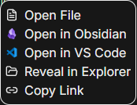

# Obsidian Bridge

**From an AI conversation to the note that matters. One right-click.**

Created and maintained by **[Artem Albino · @AG-albino](https://github.com/AG-albino)**.

Obsidian Bridge adds **Open in Obsidian** to CC GUI's file-link menu, immediately above the selected editor. The familiar purple icon makes it easy to find; the original note opens in its own vault.

> **Compatibility status:** this plugin depends on the proposed CC GUI SDK **0.3.22** file-link menu API ([upstream PR #1429](https://github.com/zhukunpenglinyutong/desktop-cc-gui/pull/1429)). It is not installable on current unmodified releases. Version 1.0.0 is prepared as a **draft release**; marketplace submission will follow acceptance and release of the host API. CC GUI's SDK compatibility check rejects older hosts rather than activating a broken plugin. The final SDK number may be coordinated by upstream before release.



## What it does

- Adds a native file-menu action, without replacing Markdown links or the existing editor actions.
- Uses the path of the link you clicked, including workspace-relative links resolved by CC GUI.
- Preserves Cyrillic, Chinese, spaces and special characters in file names.
- Provides English, Chinese and Russian labels, and the Obsidian icon.
- Hands the request to Obsidian through its [official `obsidian://open?path=…` protocol](https://obsidian.md/help/uri). The note must belong to a vault already registered in Obsidian; no note is copied and no vault is created.

## Install when the host API is available

1. Install and run Obsidian once so its URI handler is registered.
2. Use a CC GUI build exposing `ctx.ui.registerFileLinkMenuItem` with SDK 0.3.22 or later.
3. Download and extract `obsidian-bridge-1.0.0.zip` from the matching release, or use this repository's root folder. The ZIP preserves the icon and screenshot paths declared by the manifest.
4. In CC GUI choose **Plugins → Install from directory** and select that folder. Review the declared permissions.
5. Right-click a file link and choose **Open in Obsidian**.

To update a local installation, install the folder again; CC GUI hot-reloads it. To disable or remove it, use the Installed plugins tab. The host automatically removes the menu action. Obsidian stays open independently.

## Permissions and privacy

| Permission | Purpose |
| --- | --- |
| `ui:file-link-menu` | Add the action and receive the specific file link selected by the user. |
| `exec:powershell` | Windows: ask the system to handle the strictly encoded Obsidian URI, without displaying a console. |
| `exec:open` | macOS: invoke the registered URI handler. |
| `exec:xdg-open` | Linux: invoke the registered URI handler. |

Only the launcher for the current OS is used. The launcher is explicitly detached so a new Obsidian window survives the launcher, plugin unload and CC GUI exit. Missing executables are reported through the host; failures inside a detached URI handler are handled by the OS/Obsidian.

**No network calls, analytics, conversation collection, file reads, file writes or plugin storage.** The selected path is passed locally to Obsidian after a user click. The plugin is hidden in CC GUI web access because these launchers run on the desktop host.

## Build and verify

No dependencies or bundler are needed. With Node.js 20 or later:

```sh
npm test
npm run validate
npm run build
```

The same scripts work with pnpm. `dist/` is an installable folder with the runtime files, artwork and checksums; it also contains a deterministic ZIP for local installation. The three loose runtime assets remain available for the marketplace. GitHub Actions builds the draft release directly from the exact version tag; artifacts are not uploaded from a developer machine. The readable root `main.js` is the release source.

## 中文

在 CC GUI 文件链接的右键菜单中添加带图标的「在 Obsidian 中打开」，位于外部编辑器之前。依赖尚待上游接受的 SDK 0.3.22，当前正式客户端不可直接安装。只通过已声明的本机启动命令打开 Obsidian URI，不联网、不读取聊天或文件内容。文件必须位于 Obsidian 已登记的 vault 中。

作者与维护者：**[Artem Albino / AG-albino](https://github.com/AG-albino)**。

## По-русски

Пункт «Открыть в Obsidian» с фирменной иконкой появляется над выбранным редактором в меню файловой ссылки. Нужен SDK 0.3.22 с новым API; публикация в маркетплейсе ждёт его принятия. Плагин передаёт Obsidian только путь выбранного файла, не читает переписку и содержимое заметок.

Автор и сопровождающий — **[Артём Альбино · AG-albino](https://github.com/AG-albino)**.

## Credits

MIT-licensed plugin source and bridge artwork by Artem Albino. The Obsidian name and the Obsidian brand icon in the menu belong to their respective owners; they are used to identify the integration and are not covered by the plugin's MIT license. This is an independent community project, with no claim of official endorsement by Obsidian or CC GUI.
